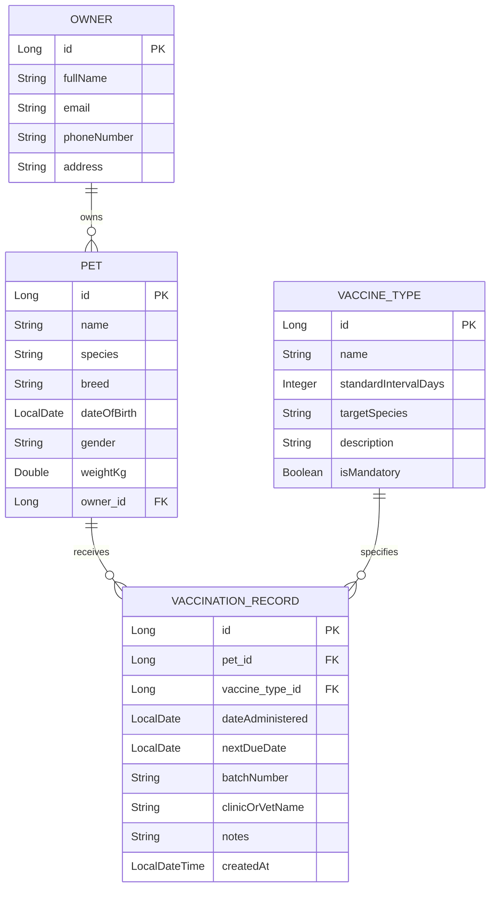

# PetCareBook 🐾💉
### Automated Pet Vaccination & Deworming Health Tracker

A production-ready **Spring Boot & Modern Web Dashboard** backend system designed to ensure pets never miss crucial immunization or deworming boosters.

---

## 🌟 Real-World Problem & Solution

Pet owners often miss critical vaccination and deworming schedules because reminders are informal, scattered, or forgotten. Delayed boosters risk severe health complications for pets (e.g. Parvovirus, Distemper, Rabies, and parasitic infections). 

**PetCareBook** provides a centralized, automated digital platform that:
1. Stores complete pet profiles and immunization histories.
2. Automatically calculates next due dates based on fixed, standard veterinary protocols.
3. Proactively alerts owners and clinics of vaccinations due in the next 7 days.
4. Strictly enforces business rules preventing future-dated entries or corrupted schedules.

---

## 🚀 Core Features

- **🐾 1. Pet Registration**: Register pets with name, species (Dog, Cat, etc.), breed, date of birth (auto-calculating age), gender, weight, and owner contact details.
- **💉 2. Log Vaccination Events**: Record immunizations with vaccine type, date administered, batch/lot number, clinic name, and veterinarian notes.
- **⚡ 3. Automatic Next Due Date Calculation**: Computes `nextDueDate = dateAdministered + vaccineType.standardIntervalDays` automatically in the Service layer before persisting.
- **⏰ 4. Due-in-7-Days Proactive Alerts**: Endpoint `GET /api/vaccinations/due-soon` retrieves all pets requiring boosters in the upcoming 7 days to trigger timely reminders.
- **📜 5. Complete Pet Vaccination History**: Owners and veterinarians can inspect a pet's complete chronological medical passport with countdown badges (`UP_TO_DATE`, `DUE_SOON`, `OVERDUE`).
- **📊 6. Executive Dashboard & Search**: Aggregate KPIs (total pets, owners, due in 7 days, overdue count) and instant search by keyword or species.

---

## 🛡️ Enforced Business Rules

1. **Strict Non-Future Dates**: A vaccination record **cannot** be logged with a future date (`dateAdministered.isAfter(LocalDate.now())`). The Service layer immediately rejects invalid dates with a custom `InvalidVaccinationDateException` and HTTP 400 Bad Request.
2. **Fixed Interval Scheduling**: Each vaccine type has a fixed standard interval (e.g. 365 days for Rabies, 90 days for Deworming, 180 days for Bordetella) enforced during date calculation.
3. **Structured Global Error Responses**: `@RestControllerAdvice` translates bean validation errors and domain rule violations into clean, consistent JSON error responses rather than raw stack traces.

---

## 🏗️ Architecture & Database Design



---

## 📡 REST API Reference

| Method | Endpoint | Description |
|---|---|---|
| `POST` | `/api/pets` | **Core Feature 1**: Register a new pet and owner |
| `GET` | `/api/pets` | List all registered pets |
| `GET` | `/api/pets/search?keyword={kw}&species={sp}` | Search and filter pets by name, breed, or species |
| `GET` | `/api/pets/{id}` | Get pet profile by ID |
| `GET` | `/api/pets/{petId}/vaccinations` | **Core Feature 5**: View a pet's complete vaccination history |
| `POST` | `/api/vaccinations` | **Core Features 2 & 3**: Log vaccination & auto-calculate next due date |
| `GET` | `/api/vaccinations/due-soon?days=7` | **Core Feature 4**: List vaccinations due in the next 7 days |
| `GET` | `/api/vaccinations` | Retrieve all vaccination records |
| `GET` | `/api/vaccine-types` | List standard vaccine protocols and intervals |
| `POST` | `/api/vaccine-types` | Add a new vaccine protocol |
| `GET` | `/api/dashboard/stats` | Overview metrics (total pets, due in 7 days, overdue) |

---

## 🧪 Testing Edge Cases

### 1. Normal Path (Valid Log)
```bash
POST /api/vaccinations
Content-Type: application/json

{
  "petId": 1,
  "vaccineTypeId": 1,
  "dateAdministered": "2026-09-28",
  "batchNumber": "RAB-2026-A1",
  "clinicOrVetName": "City Vet Hospital",
  "notes": "Annual Rabies booster given."
}
```
**Response (HTTP 201 Created):**
```json
{
  "id": 5,
  "petId": 1,
  "petName": "Milo",
  "vaccineName": "Rabies Core Vaccine",
  "dateAdministered": "2026-09-28",
  "nextDueDate": "2027-09-28",
  "standardIntervalDays": 365,
  "daysRemaining": 365,
  "status": "UP_TO_DATE"
}
```

### 2. Edge Case: Future Date Rejection (Business Rule 1)
```bash
POST /api/vaccinations
Content-Type: application/json

{
  "petId": 1,
  "vaccineTypeId": 1,
  "dateAdministered": "2026-10-15"
}
```
**Response (HTTP 400 Bad Request):**
```json
{
  "status": 400,
  "error": "Invalid Vaccination Date",
  "message": "Vaccination date cannot be in the future. Provided date: 2026-10-15, Current system date: 2026-09-28",
  "path": "/api/vaccinations"
}
```

---

## 🛠️ Quick Start

### 1. Start Application
```powershell
cd "C:\Users\welcome\Desktop\springboot\PetCareBook"
.\mvnw.cmd spring-boot:run
```
*(Or double-click `run-app.bat`)*

### 2. Access Web Dashboard & Swagger Docs
- **Interactive Web App**: [http://localhost:8080/](http://localhost:8080/)
- **Swagger OpenAPI Docs**: [http://localhost:8080/swagger-ui.html](http://localhost:8080/swagger-ui.html)
